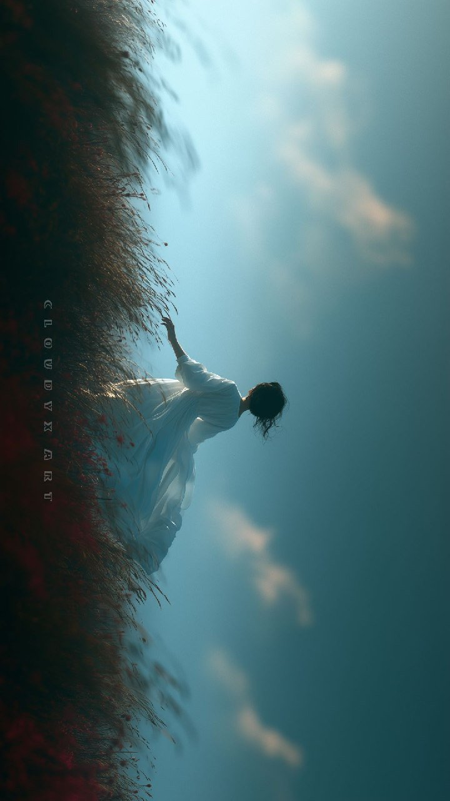
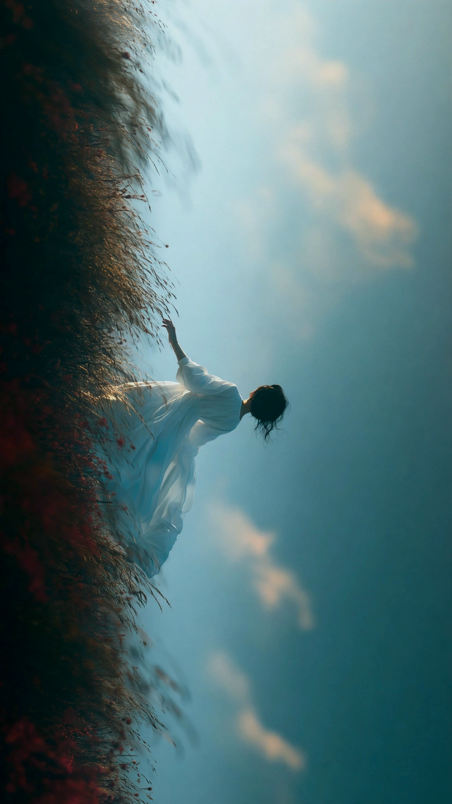
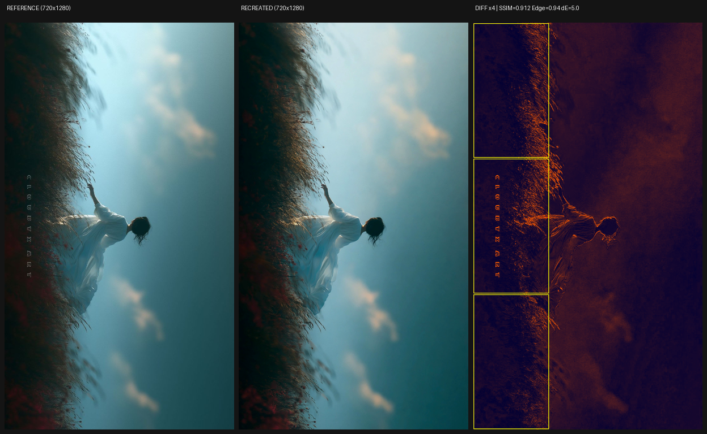

# rea-image

Reverse-engineer any image with deep deterministic forensics, optical and physical realism analysis, and closed-loop multi-pass reconstruction to achieve maximum 1:1 visual parity ("exact same to same").

Measure every pixel property deterministically, pin every object to exact coordinates, enforce realistic lighting / camera / material / anatomy physics, route to the exact production medium of the image, and verify every pass quantitatively before delivering.

> **What this is:** a skill (prompt + scripts) for AI assistants, not an app. It tells an agent how to inspect, recreate and verify an image, with the Python tools to do the measuring.

## Example — woman in white dress (25 Nov 2026)

A cinematic teal-and-gold image, 720 x 1280, 9:16. Reference on the left, recreation after LAB calibration in the middle, and the verification comparison (Reference | Recreated | 4x amplified diff heatmap) below.

| Reference | Recreated (calibrated) |
|---|---|
|  |  |



| | Pass 1 (generation) | Pass 2 (after LAB calibration) |
|---|---:|---:|
| Reference | 720 x 1280, 9:16 | 720 x 1280, 9:16 |
| Recreated | 1152 x 2048 | 720 x 1280 |
| **SSIM** | 0.9033 | **0.9121** |
| **Edge correlation** | 0.9370 | **0.9381** |
| Colour histogram similarity | 0.8517 | 0.8475 |
| **Mean LAB Delta-E** | 8.19 | **5.01** |
| Global luminance bias | 15.79 | 4.08 |

All example files are in `examples/woman-white-dress/`:

- `reference.jpg` — the original reference image
- `clone-calibrated.png` — the final recreated image after calibration
- `comparison.png` — Reference | Recreated | 4x amplified diff heatmap
- `grid-overlay.png` — 6x6 coordinate grid used to lock every object in place
- `IMAGE.md` — the full forensic blueprint (palette, 9-zone map, layout, optics, physics audit)
- `metrics.json` — the full per-zone metrics from the final verification pass

## How it works — 6 stages

1. **Forensic extraction** — `scripts/inspect_image.py` measures exact `W x H`, aspect ratio, EXIF / PNG / AIGC metadata, a 12-colour global hex palette, a 9-zone (3x3) spatial hex + luminance + saturation map, tone-curve percentiles (`p02`, `p15`, `p50`, `p85`, `p98`), colour temperature, directional lighting, sharpness / grain (Laplacian variance), edge density and flat-region ratio. It also renders a 6x6 coordinate grid overlay and a 3x3 tile sheet.
2. **Visual review, physics audit & classification** — classify the image (10 classes in `references/taxonomy.md`), audit camera optics, lighting physics, materials and anatomy (`references/physics-and-optics.md`), and record the full forensic blueprint in `IMAGE.md`.
3. **Route to the highest-fidelity pipeline** (`references/recreation-routes.md`):
   - **Route A** — Reference-locked multi-pass generative recreation (photos, AI art, 3D renders, illustrations, collages)
   - **Route B** — Pixel-exact deterministic code recreation (UI, charts, diagrams, infographics, vectors, logos, typographic posters)
   - **Route C** — Two-stage hybrid compositing (thumbnails, ad creatives, covers, banners)
   - **Route D** — Pixel-preserving compositing (localised edits, swaps, restoration, colour / crop fixes)
4. **Closed-loop verification** — after every pass, `scripts/verify_clone.py` measures per-zone SSIM, edge correlation, LAB Delta-E, colour-histogram similarity and luminance bias, and prints auto-fix directives plus a 4x amplified diff heatmap.
5. **Calibration** — when structure aligns but colour / exposure drifts, `scripts/calibrate_clone.py` does a LAB colour-grade transfer (`--strength 0.70` by default).
6. **Final inspection & clean delivery** — visual physics check, then report the forensic summary with the actual measured metrics.

## Install

This is a skill, not a pip package. Copy the whole repo into your agent's skills folder (for example `~/.claude/skills/rea-image/`), or point your agent at this repo.

Requirements for the scripts: Python 3, `Pillow`, `numpy`, `opencv-python` (`cv2`), `scipy`.

```bash
pip install pillow numpy opencv-python scipy
```

## Usage

```bash
# 1. Inspect a reference image
python3 scripts/inspect_image.py <reference_image> --out <work_dir>/forensics

# 2. Recreate it (Route A/B/C/D, per SKILL.md), then verify every pass
python3 scripts/verify_clone.py <reference_image> <recreated_image> --out <work_dir>/verify_p1

# 3. If colour / exposure drifts, calibrate and re-verify
python3 scripts/calibrate_clone.py <reference_image> <recreated_image> --out <work_dir>/calibrated.png --strength 0.70
python3 scripts/verify_clone.py <reference_image> <work_dir>/calibrated.png --out <work_dir>/verify_p2
```

Full workflow, rules and gotchas: see [`SKILL.md`](SKILL.md).

## Files

```
SKILL.md                          # the skill: full 6-stage workflow
references/
  taxonomy.md                     # 10 image classes
  physics-and-optics.md           # camera / lighting / material / anatomy audit
  recreation-routes.md            # Routes A–D
scripts/
  inspect_image.py                # forensic extraction (palette, zones, tone, light, grid)
  verify_clone.py                 # SSIM / edge / LAB Delta-E verification + diff heatmap
  calibrate_clone.py              # LAB colour-grade calibration
examples/
  woman-white-dress/              # verified example with proof images + metrics
```

## Rules that matter

- **Never eyeball hex codes, dimensions or placements.** Always read exact values from `inspect_image.py` and the grid overlay.
- **Never skip `verify_clone.py` after Pass 1.** The diff heatmap and auto-fix directives expose shifts a casual look misses.
- **Do not use pure diffusion for pixel-exact UIs, charts, vectors or typographic posters.** Use Route B code rendering.
- **Always enforce physical realism** — focal-plane blur, rim-light direction, shadow softness, fabric drape, hand / limb anatomy — before accepting a pass.

## License

Use freely. The example reference image is included only to demonstrate the verification workflow.
